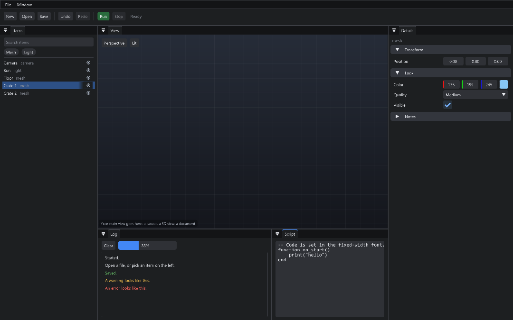
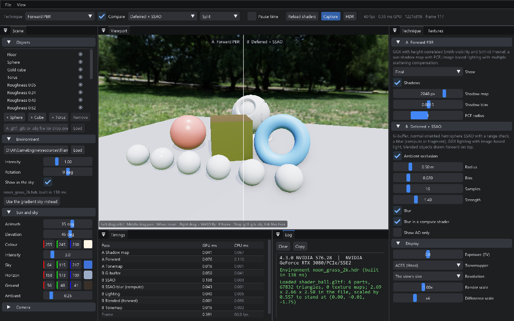
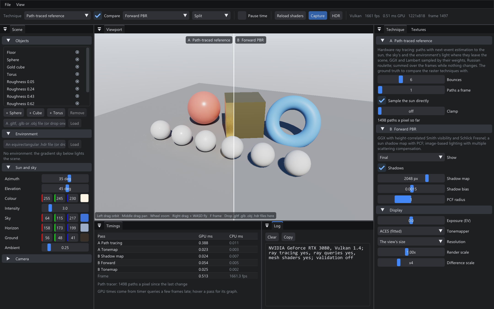

# R_ImGUI

The look of IdlyEngine's editor for any [Dear ImGui](https://github.com/ocornut/imgui) desktop application, and a kit
for realtime rendering research built on it.

| Template | What it is |
|---|---|
| **starter** | A tool with the editor's look: the theme, fonts, toolbar strip, property panels and buttons |
| **renderlab** | A renderer research application: write techniques, compare them side by side, time every pass, look at every buffer |
| **renderlab-vulkan** | The same application on Vulkan 1.3, adding a path-traced reference, ray-traced shadows and AO, mesh shaders, and HLSL beside GLSL |







## Make a new application

```powershell
.\tools\new_app.ps1 -Name MyTool -Destination D:\Projects
.\tools\new_app.ps1 -Name ShadowLab -Template renderlab -Destination D:\Research
.\tools\new_app.ps1 -Name LightLab -Template renderlab-vulkan -Destination D:\Research
```

Each creates a folder holding its own copy of the libraries (`rimgui\`), which builds without this repository:

```powershell
cd D:\Research\ShadowLab
cmake -B build
cmake --build build --config Release
```

Add `-Build` to configure and build straight away. You need CMake 3.24 or later, a C++20 compiler (Visual Studio 2022 on
Windows) and OpenGL 3.3; RenderLab asks for OpenGL 4.3 (for compute shaders) and works with 3.3 without them.
RenderLabVulkan needs the [Vulkan SDK](https://vulkan.lunarg.com) (1.3.236 or later; its installer sets `VULKAN_SDK`)
and a GPU with Vulkan 1.3.

## The look (`rimgui`)

| | |
|---|---|
| **Colours** | Charcoal panels, one blue for what is selected or active, green to start, red to stop; `rimgui::palette()` for your own drawing |
| **Text** | Segoe UI at 15 px for the interface, Consolas for code (`rimgui::push_code_font()`); ImGui's own font where those are missing |
| **Scale** | Sizes and text follow the monitor's scale; `rimgui::px(12)` is 12 px at 100%, whatever the scale now |
| **Layout** | A dock space split like the editor's: a toolbar strip on top, a list on the left, details on the right, a log below, the main view in the middle |
| **Widgets** | `begin_toolbar` and `divider`, `button` in Go, Stop and Accent tones, `section`, `begin_properties` and `property` rows, `chip` filters, `row_toggle`, `hint`, `text_good`, `text_warning` and `text_error`, `overlay_caption` |
| **App shell** | `rimgui::run(config, frame)`: the window, OpenGL or Vulkan (`--vulkan`, `--validation`; `rimgui/vulkan.h`), ImGui with docking, the theme and fonts, `on_start` and `on_exit` for GPU resources, and `--screenshot <file.ppm>` for docs and tests |

```cpp
ImGui::Begin("Details");
if (rimgui::section("Transform") && rimgui::begin_properties("##transform")) {
    rimgui::property("Position", "Where it is, in metres");
    ImGui::DragFloat3("##position", position, 0.05f);
    rimgui::end_properties();
}
ImGui::End();
```

## The research kit (`rimgui_rt`) and RenderLab

A technique is a class with a name, its settings and a `render()`; the lab gives it everything else.

```cpp
class MyAO : public rimgui::rt::Technique {
public:
    std::string name() const override { return "My AO"; }
    void settings() override { ImGui::SliderFloat("Radius", &radius_, 0.05f, 2); }
    void serialize(rimgui::rt::Settings &s) override { s.value("radius", radius_); }   // kept between runs
    void render(rimgui::rt::Frame &frame) override {
        auto timed = frame.scope("Main");                       // shows in Timings, GPU and CPU
        auto &p = frame.shaders->graphics("my_ao", "mesh.vert", "my_ao.frag");
        if (p.ready()) {
            p.use();
            frame.set_camera(p);                                // u_view_projection and the rest
            frame.set_lighting(p);                              // the sun, the sky, the HDR environment
            p.set("u_radius", radius_);
            frame.scene->draw(p);                               // every object, its material and its maps
        }
        frame.draw_sky();
        frame.expose_depth("Depth", *frame.output);             // shows in Textures
    }
private:
    float radius_ = 0.5f;
};
```

In the fragment shader, the kit's includes do the common work:

```glsl
#include "rimgui_material.glsl"   // Surface s = surface(v_world, v_normal, v_uv): maps, normal mapping, alpha mask
#include "rimgui_lighting.glsl"   // the sun, ambient_light(...): image-based lighting with the split-sum BRDF table
```

| Panel | What it does |
|---|---|
| **Viewport** | The technique's HDR picture, tonemapped (ACES, Reinhard, clamp; exposure). NaN and infinite pixels show magenta. At the view's size times a render scale (0.25x to 2x), or a fixed 720p to 4K shown letterboxed. Left drag orbits, middle drag pans, the wheel zooms, right drag with WASD flies, F frames the scene |
| **Compare** | A/B: two techniques split by a line you drag, or the difference between them in false colour, scaled up to 100x |
| **Technique** | The chosen techniques' settings; a technique that throws stops with its message and a Retry button, and the lab goes on |
| **Scene** | Objects and their materials and maps (each map can be switched off), glTF and OBJ models, the HDR environment (intensity, rotation, shown as the sky or not), the sun and sky, the camera (with its view as a command-line option to copy) |
| **Textures** | Every texture a technique exposed this frame, by channel (RGB, R, G, B, A) and range; depth shown in metres; shown in the panel or over the whole view |
| **Timings** | GPU time of each pass from timer queries (read a few frames late, so nothing stalls), CPU time, a graph on hover |
| **Log** | Shader errors with the file and line they are on, also inside `#include`d files; OpenGL errors and debug messages; what a model file had that was skipped |

Drop `.gltf`, `.glb`, `.obj` and `.hdr` files on the window to load them, and a PNG or JPEG to make it the selected object's albedo map. The lab keeps its state (camera, scene, models, environment, every technique's settings) in `RenderLab.settings` beside the program, saved every two seconds when something changes, so a crash loses nothing; delete the file to start afresh.

What the kit gives a technique:

- **Shaders:** `ShaderLibrary` builds programs from files and rebuilds them when you save. `#include "file"` works. A program that fails keeps its last good version, so the picture stays up while you fix it.
- **Materials:** glTF's metal-roughness model: albedo, alpha, roughness, metallic, emissive and their maps (normal, metal-roughness, occlusion, emissive), alpha mask and blend, double-sided. Normal maps need no tangents (the frame comes from screen-space derivatives).
- **Models:** glTF 2.0 (`.gltf` with its files, `.glb`, embedded and data-URI images) and OBJ. A file that needs something the loader does not do (Draco or meshopt compression, WebP or Basis images) is refused by name, never loaded as nothing.
- **Image-based lighting:** an equirectangular `.hdr` becomes a cubemap, irradiance, a GGX-prefiltered mip chain and a BRDF table on the GPU (about 150 ms for a 2K image), in 32-bit float so a photographed sun cannot overflow; `ambient_light()` adds multiple-scattering energy compensation.
- **Render targets:** `RenderTarget` is a framebuffer with any colour formats (RGBA8 to RGBA32F, R16F, R11G11B10F...) and a sampleable depth texture, resized on demand. `make_texture` makes images for compute shaders.
- **Compute:** `glDispatchCompute`, `glMemoryBarrier`, `glBindImageTexture` and `glTexStorage2D`, with OpenGL 4.3; `ShaderLibrary::compute` builds and reloads compute shaders.
- **Progressive techniques:** `frame.accumulation` counts frames since anything changed (camera, scene, environment, size, settings), for path tracers and temporal accumulation; Pause time holds `frame.time` still.
- **Meshes:** spheres, cubes, planes and tori; `draw_fullscreen_triangle()` for full-screen passes.
- **Math:** `vec3`, `mat4`, `perspective`, `orthographic`, `look_at` and `inverse`, laid out as GLSL wants them.
- **Capture:** PNG of the view (both sides when comparing), and the linear HDR output as a Radiance `.hdr` before tonemapping.

RenderLab starts with three techniques to copy from:
- **Forward PBR:** GGX with height-correlated Smith visibility and Schlick Fresnel, a sun shadow map with PCF (alpha-masked casters cut holes), image-based lighting, blended objects back to front, and views of the sun's diffuse and specular, the shadow term, normals and ambient light alone.
- **Forward Blinn-Phong.**
- **Deferred + SSAO:** a G-buffer, hemisphere SSAO with a range check, a blur in a compute shader (or a fragment shader without OpenGL 4.3), a lighting pass, and blended objects drawn forward on top.

Their shaders are in `templates/renderlab/shaders/`; the shared BRDF, lighting and material code is in `rimgui/shaders/rimgui_*.glsl` (copy one into your shaders folder under the same name to change it for your application). A row of spheres from smooth to rough sits in the default scene for comparing BRDFs.

Command-line options, for scripted and reproducible captures:

```text
RenderLab.exe --technique "Deferred + SSAO" --compare "Forward PBR" [--difference]
              --model helmet.glb --environment sky.hdr --scene empty
              --camera 0.9,0.7,-1.8,3.6,8,10 --resolution 1920x1080
              --screenshot out.ppm --screenshot-frame 120
RenderLab.exe --show "SSAO blurred"
RenderLab.exe --check --hidden --log check.log     exit 0: drew a picture with no errors; 3: errors; 4: blank
```

Screenshots and checks start from the defaults and do not save settings, so they come out the same every time.
`--save-view out.png` saves just the view's picture after `--frames <n>` frames (90 by default).

## RenderLab on Vulkan (`rimgui_rt_vk`) and RenderLabVulkan

The same application (both labs share one core for the panels, settings, command line, captures and checks), with
techniques written in Vulkan 1.3. A technique records into `frame.cb`, the frame's command buffer:

```cpp
class MyPass : public rimgui::rt::vk::Technique {
    std::string name() const override { return "My pass"; }
    void render(rimgui::rt::vk::Frame &frame) override {
        auto timed = frame.scope("Main");
        rimgui::rt::vk::GraphicsDesc d;
        d.vertex = "mesh.vert";                                 // or d.task / d.mesh, or "file.hlsl:Entry"
        d.fragment = "my_pass.frag";
        d.colors = frame.output->color_formats();
        d.depth = frame.output->depth_format();
        auto &p = frame.shaders->graphics("my pass", d);
        frame.begin_output();
        frame.scene->draw(frame.cb, p, rimgui::rt::DrawFilter::Opaque, frame.camera_position, frame.constants());
        frame.draw_sky();
        frame.end_output();
    }
};
```

What the Vulkan kit gives a technique:

- **Bindless resources:** every texture, cubemap and storage image in one descriptor set, picked by index in shaders
  (`rimgui_vk.glsl`, `rimgui_vk.hlsl`); buffers by device address; one pipeline layout with 256 bytes of push
  constants. Images stay in `VK_IMAGE_LAYOUT_GENERAL`; `barrier(cb)` between passes.
- **The scene on the GPU:** meshes in buffers read by vertex pulling, `FrameData` (camera, sun, sky, environment, every
  object) and `ObjectData` (transform, material, mesh) read by address (`rimgui_vk_scene.glsl`), with the same material
  and lighting code as the OpenGL kit (`rimgui_vk_material.glsl`, `rimgui_vk_lighting.glsl`, and their `.hlsl` twins).
- **Shaders:** GLSL through shaderc and HLSL through DXC, rebuilt when saved, `#include`, errors at their file and line,
  the last good pipeline kept; graphics, mesh, compute and ray tracing pipelines (with the shader binding table).
- **Ray tracing:** `frame.prepare_ray_tracing()` keeps the scene's acceleration structures current (one bottom level
  per mesh; the top level rebuilt only when the geometry changes); `rimgui_vk_raytracing.glsl` gives the surface at a
  hit, alpha tests for masked and blended materials, random numbers and GGX sampling.
- **Mesh shaders:** meshes cut into meshlets (`rimgui/rt/meshlets.h`) with bounding spheres and normal cones.
- **Image-based lighting** built by compute shaders, **GPU timestamps** per pass, and `--validation`, under which any
  message from the validation layers is logged as an error, so `--check --validation` fails on misuse of the API.

RenderLabVulkan's techniques:

| Technique | What it shows |
|---|---|
| **Forward PBR** | The OpenGL lab's Forward PBR in Vulkan; the two labs' pictures agree within 0.05 levels |
| **Forward PBR (HLSL)** | The same with its shaders in HLSL through DXC: the same picture as the GLSL one |
| **Forward Blinn-Phong** | As in the OpenGL lab |
| **Deferred + SSAO** | A G-buffer, then SSAO, a blur and the lighting as compute passes |
| **Hybrid RT shadows + AO** | The G-buffer with soft sun shadows and ambient occlusion traced by ray queries, averaged while nothing moves |
| **Path-traced reference** | An RT pipeline: next-event estimation to the sun, sky and environment light, GGX and Lambert sampling, Russian roulette, accumulation; the ground truth to compare the others with |
| **Mesh shaders (meshlets)** | Forward PBR through a task shader that culls meshlets outside the view or facing away, and a mesh shader; Timings shows how many were culled |
| **Sky and environment** | The background alone |

On a GPU without ray tracing or mesh shaders those techniques say so and draw only the sky; the others work.

## Tests

```powershell
ctest --test-dir build
```

- `rimgui_rt_tests` holds the kit to answers known exactly (68 checks):
  - a sky of one brightness gives that brightness back from the irradiance and every prefiltered level;
  - the BRDF table gives F0 untouched for a smooth surface seen head-on;
  - a sky with a blinding sun gives no infinity or NaN;
  - a shader error inside an included file is reported at that file's line, and a broken edit keeps the last good build;
  - every render-target format makes a complete framebuffer;
  - glTF factors, maps, alpha, node transforms and bounds are read;
  - a Draco file is refused by name;
  - settings come back as saved;
  - a compute shader writes every pixel;
  - every triangle lands in exactly one meshlet, and a floor's normal cones cull it from below only.
- `renderlab.*` runs RenderLab with `--check` in a hidden window for every technique, both compare modes, with an HDR environment, and at a fixed resolution.
- With the Vulkan SDK, all under the validation layers (any message from them fails the test):
  - `rimgui_vk_tests` (41 checks): buffers, GLSL and HLSL compute, errors in included files and reloads, graphics,
    textures and mips, ray tracing and mesh shader pipelines, the IBL maps against known answers, a ray query hitting a
    cube at the exact distance (and missing it hidden, finding it moved), and GPU timestamps;
  - `renderlab_vk.*`: RenderLabVulkan's `--check` for every technique, both compare modes, with an environment;
  - `agreement.*`: the same technique drawn by both labs, compared pixel by pixel;
  - `languages`, `meshlets.*`: HLSL against GLSL, and mesh shaders against Forward PBR (also in a close-up where most
    meshlets are culled): the same pictures;
  - `convergence.path_traced`: the path tracer after 256 frames is close to the one after 1024.

## Limits

- **OpenGL and Vulkan; no Direct3D 12 or Metal.** The Vulkan lab needs Vulkan 1.3; ray tracing and mesh shaders need GPUs that have them.
- **The path tracer** samples the sun directly and finds the sky and environment by its bounces (no importance sampling of the environment image), so small bright spots in an HDR image converge slowly. Rays read materials at the top mip level.
- **Ray tracing scenes** rebuild their top level when the geometry changes, waiting for the GPU first: dragging an object stalls briefly each frame.
- **Compressed glTF** (Draco, meshopt) and **WebP or Basis textures** are refused with a message: decompress them first.
- **glTF extensions beyond metal-roughness** (transmission, clearcoat, sheen, texture transforms) are named in the Log and left out; skins and animations draw in the bind pose.
- Built and tested on Windows (Visual Studio 2022, an RTX 3080). The code avoids Windows-only calls except for finding the system fonts, but has not been built on Linux or macOS.

## What is in this repository

```text
rimgui/                  the libraries: rimgui (the look and the shell), rimgui_rt_core (no graphics API), rimgui_rt
                         (OpenGL kit), rimgui_rt_vk (Vulkan kit), with the kits' shaders
templates/starter/       StarterApp
templates/renderlab/     RenderLab: three techniques and their shaders
templates/renderlab-vulkan/  RenderLabVulkan: eight techniques and their shaders
tests/                   the kits' tests and both labs' end-to-end checks
tools/new_app.ps1        makes a new application from a template
docs/VULKAN_PLAN.md      how the Vulkan lab was built, slice by slice
```

Building here builds the libraries, the templates and the tests (`build\bin\StarterApp.exe`, `build\bin\RenderLab.exe`,
and with the Vulkan SDK `build\bin\renderlab-vulkan\RenderLabVulkan.exe`). Without the SDK the Vulkan parts are left
out and everything else builds (`-DRIMGUI_VULKAN=OFF` leaves them out on purpose).

## Dependencies

Dear ImGui (docking branch) and GLFW, fetched on the first configure at pinned commits, the ones IdlyEngine's editor
uses. The OpenGL loader (glad) comes with GLFW. stb_image, stb_image_write and cgltf are kept in
`rimgui/third_party` (see its README for versions and licences). The Vulkan parts use the Vulkan SDK's Volk, VMA,
shaderc and DXC (`dxcompiler.dll` is copied beside each Vulkan program). To build without a network, point at local copies of
ImGui and GLFW:

```powershell
cmake -B build -DRIMGUI_IMGUI_DIR=D:\libs\imgui -DRIMGUI_GLFW_DIR=D:\libs\glfw
```
